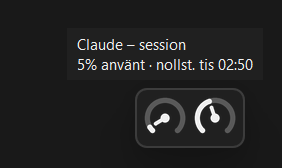
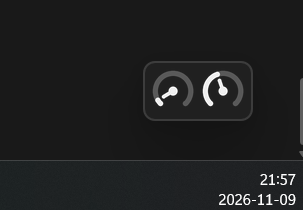

# Claude Usage Tray

> **Disclaimer:** This is an unofficial hobby project. It is not affiliated with, endorsed by or supported by Anthropic.
> It uses claude.ai's undocumented internal API, which can change or stop working at any time. Use it at your own risk.

A small Windows app that shows how much of your Claude usage limits you have used, as two gauges in the system tray and in an optional floating widget.



| Tray icons | Widget on the desktop |
|---|---|
|  |  |

*The screenshots show the Swedish interface.*

## Download

No Python needed. **[Download the latest release](https://github.com/SoperX2/claude-usage-tray/releases/latest)**

1. **Download** `ClaudeUsage.exe` from the release and put it in a folder where it can stay, for example `Documents\Claude Usage`
2. **Double-click** it
3. **Paste your `sessionKey`** when the app asks for it (see [Getting your sessionKey](#getting-your-sessionkey))

The two gauges show up in the system tray, and the widget in the bottom-right corner of the screen. Windows 11 puts new tray icons in the hidden `^` overflow menu: drag them out to the taskbar once and they will stay there.

If you move the exe to another folder later, Windows treats it as a new app: drag the tray icons out again. If you use **Start with Windows**, its check mark is now empty: choose it once to make Windows start the exe from the new folder.

### "Windows protected your PC"

The exe is not code-signed, so Windows SmartScreen warns the first time you start it. Click **More info** → **Run anyway** ("Mer information" → "Kör ändå" in Swedish Windows).

If you want to check the file before you run it:

- **It is built from this repo.** Each release is built by [GitHub Actions](.github/workflows/release.yml) from the source code you can read here, not on someone's computer.
- **Compare the checksum.** Each release has a `ClaudeUsage.exe.sha256` file. Run this in PowerShell. It downloads the checksum of the latest release and compares it with the exe in your Downloads folder. It prints `True` if they match:
  ```powershell
  Invoke-WebRequest "https://github.com/SoperX2/claude-usage-tray/releases/latest/download/ClaudeUsage.exe.sha256" -OutFile "$env:TEMP\cu.sha256"
  $expected = ((Get-Content "$env:TEMP\cu.sha256" -Raw).Trim() -split '\s+')[0]
  (Get-FileHash "$env:USERPROFILE\Downloads\ClaudeUsage.exe").Hash -eq $expected
  ```
  If you saved the exe somewhere else, change the path on the last line.
- **Check the VirusTotal report.** New releases are uploaded to [VirusTotal](https://www.virustotal.com/) when they are published. When the scan succeeds, the release notes show how many antivirus engines flagged the exe, with a link to the full report. If the line is missing, the scan did not run or failed: that says nothing about the file, and you can upload it to VirusTotal yourself.
- **Antivirus software** sometimes flags apps built with PyInstaller even when they are harmless, because some malware is packaged the same way.

**Smart App Control:** on Windows 11 with Smart App Control turned on, Windows can block unsigned apps completely, with no **Run anyway** button. Then [run it from source](#run-from-source) instead.

### If Microsoft Defender removes the file

Windows has three different protections that can stop the exe. They are easy to mix up:

| | What happens | What it means |
|---|---|---|
| **SmartScreen** | A blue "Windows protected your PC" window when you start the exe. The file is still there | Windows has not seen this file often enough to trust it. It is not a virus warning. Click **More info** → **Run anyway** |
| **Microsoft Defender Antivirus** (real-time protection) | A "Threats found" notification, and the exe disappears or cannot be started | Defender has flagged the file as malware and moved it to quarantine. If the checksum matches the release, this is a false positive |
| **Smart App Control** (Windows 11 only) | The exe is blocked with no way to run it anyway | Windows blocks all apps that are not signed or known to Microsoft. It does not mean the file is harmful. [Run it from source](#run-from-source) instead |

If Defender removed the file:

1. **Check that it is really this app.** Download the exe again and compare the checksum as described above. Do not restore a file you are unsure about
2. **Report the false positive to Microsoft** at [Submit a file for malware analysis](https://www.microsoft.com/en-us/wdsi/filesubmission). Choose **Home customer**, upload `ClaudeUsage.exe`, select **Incorrectly detected as malware/malicious**, and enter the detection name. You find it in **Windows Security** → **Virus & threat protection** → **Protection history**. You can follow the submission on the same site. If Microsoft agrees it is a false positive, the fix reaches everyone through normal Defender updates
3. **After Microsoft has fixed the detection,** update Defender in **Windows Security** → **Virus & threat protection** → **Protection updates** → **Check for updates**. Then restore the file from **Protection history** → **Actions** → **Restore**, or download it again

Do not turn off real-time protection or add exclusions to get around it. Reporting it fixes it for everyone.

## Features

- **Two tray gauges:** the left one shows the current session (the 5-hour window) and the right one shows the week
- **Colours:** white, or black on a light taskbar. Orange at 80 % or more, red at 95 % or more, dimmed when the data is stale or failed to load
- **Light or dark:** the tray icons always follow the colour of the taskbar, so they stay visible. For the widget, choose **Widget appearance** in the menu: **Follow Windows** (the default), **Light** or **Dark**. **Follow Windows** uses the colour of your apps, which can differ from the taskbar's in Windows (**Settings** → **Personalization** → **Colors**). The app switches as soon as you change the theme in Windows
- **Hover** for the exact percentage and when the limit resets. **Left-click** to refresh, **right-click** for the menu
- **Windows notification** when the session or the week passes 95 % and 99 %, for example "Session: 95% used, resets 22:00". Each one is shown at most once per period, even if the app restarts. Turn them off with **Notifications** in the menu. Error notifications, for example when your login has expired, are always shown
- **Refreshes automatically** every two minutes
- **Floating widget** that stays on top, with the same two gauges (see below)
- **Start with Windows** from the menu
- **English or Swedish:** the app uses Swedish if Windows is set to Swedish, and English otherwise

### Floating widget

A small borderless window with the same two gauges, always on top. It does not show up in the taskbar or in Alt+Tab.

- **Drag** with the left mouse button to move it, also between monitors. The gauges are redrawn at the right size on monitors with different scaling
- **Double-click** to refresh
- **Right-click** for the same menu as the tray icons
- **Hover** over a gauge for details
- **Close** it with the small ✕ that appears in the corner when you hover over the widget, or with **Hide widget** in the menu. The app keeps running in the tray
- **Bring it back** with **Show widget** in the tray menu
- **Lock position** in the menu stops the widget from being dragged
- **Quit Claude Usage** in the menu exits the whole app

The widget has a dark background with light gauges, or in the light theme a near-white background with dark gauges and a thin grey border. Either way it looks the same on light and dark wallpapers. Corners are rounded on Windows 11 and square on older versions.

Position, visibility, the lock, the **Widget appearance** and **Notifications** choices and which notifications have been shown are saved in `%APPDATA%\ClaudeUsageTray\settings.json`. If the saved position is not on any connected monitor at startup, the widget is shown in the bottom-right corner of the primary monitor. The saved position is kept until you drag the widget, so it comes back if the monitor is reconnected before the next start.

## Getting your sessionKey

The first time you start the app it asks for your `sessionKey` cookie:

1. Open https://claude.ai and sign in
2. Press **F12** and open the **Application** tab (**Storage** in Firefox)
3. Go to **Cookies** → `https://claude.ai` and copy the value of `sessionKey`
4. Paste it into the dialog

When the key expires the gauges are dimmed. Right-click and choose **Change sessionKey…** to enter a new one.

## Security

- **Your `sessionKey` gives full access to your Claude account.** Treat it like a password. Never share it, post it in an issue or commit it to git.
- **It stays on your computer.** The key is stored locally in **Windows Credential Manager** (via `keyring`), not in a file.
- **It is only sent to claude.ai.** The app sends the key to `https://claude.ai` and nowhere else.
- **Removing it:** delete the `ClaudeUsageTray` entry in Credential Manager. If you think the key has leaked, sign out of claude.ai on all devices to end the session.

## Start with Windows

Right-click a gauge and choose **Start with Windows**. The app then adds an entry under `HKEY_CURRENT_USER\Software\Microsoft\Windows\CurrentVersion\Run` that starts this copy of the app when you sign in. Choose it again to remove the entry.

The check mark always shows what is in the registry. If you turn the app off under **Task Manager** → **Startup apps**, the check mark disappears, and choosing **Start with Windows** turns it back on.

## Uninstalling

1. Turn off **Start with Windows** and choose **Quit Claude Usage**
2. Delete `ClaudeUsage.exe`
3. Optionally delete the `ClaudeUsageTray` entry in Credential Manager and the folder `%APPDATA%\ClaudeUsageTray`

## Run from source

For developers, or if Windows will not let you run the exe. Requires Windows and Python 3.10 or later.

```powershell
pip install -r requirements.txt
pythonw claude_usage_tray.py
```

`pythonw` starts the app without a console window. Use `python` instead to see the log in the console. **Start with Windows** works here too: it starts the script with `pythonw.exe`.

### Tests

```powershell
python -m unittest discover tests
```

### Building the exe

```powershell
python -m venv .venv
.venv\Scripts\pip install -r requirements-build.txt
.venv\Scripts\python scripts\make_version_info.py build\version_info.txt
.venv\Scripts\pyinstaller --onefile --noconsole --noupx --name ClaudeUsage --icon assets\icon.ico --version-file build\version_info.txt claude_usage_tray.py
```

The exe ends up in `dist\`. `make_version_info.py` writes the version details that Windows shows under **Properties** → **Details**, from `__version__`, so they always match the app. `--noupx` makes sure the exe is never compressed with UPX, even if UPX is installed on your computer, because antivirus software flags UPX-packed files more often. The icon is made by `python scripts\make_icon.py` from the same gauge that the app draws.

GitHub Actions builds the exe on every push and pull request to `main`. Pushing a tag such as `v1.0.0` creates a release with the exe and its checksum. The tag must match `__version__` in `claude_usage_tray.py`. After the release, the published exe is scanned on VirusTotal (needs the `VT_API_KEY` secret). To scan an existing release again, run **Actions** → **VirusTotal** → **Run workflow** with its tag.

## How it works

The app calls the same internal endpoints that the claude.ai usage settings page uses:

- `GET https://claude.ai/api/organizations` finds the organization that has chat access
- `GET https://claude.ai/api/organizations/{org_id}/usage` returns the usage

Shortened, made-up example of the fields the app uses:

```json
[{ "uuid": "00000000-0000-0000-0000-000000000000", "capabilities": ["chat"] }]
```

```json
{
  "five_hour": { "utilization": 42.0, "resets_at": "2026-01-01T15:00:00Z" },
  "seven_day": { "utilization": 18.0, "resets_at": "2026-01-05T09:00:00Z" }
}
```

`curl_cffi` with `impersonate="chrome"` is used so that Cloudflare does not block the requests. Because the API is undocumented it can change without notice. If the gauges suddenly show "Could not fetch", that is the most likely reason.

## License

[MIT](LICENSE)
