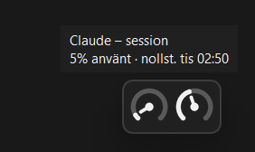
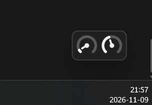

# Claude Usage Tray

> **Disclaimer:** This is an unofficial hobby project. It is not affiliated with, endorsed by or supported by Anthropic.
> It uses claude.ai's undocumented internal API, which can change or stop working at any time. Use it at your own risk.

A small Windows app that shows how much of your Claude usage limits you have used, as two gauges in the system tray and in an optional floating widget.



| Tray icons | Widget on the desktop |
|---|---|
|  |  |

## Features

- **Two tray gauges:** the left one shows the current session (the 5-hour window) and the right one shows the week
- **Colours:** white, or black on a light taskbar. Orange at 80 % or more, red at 95 % or more, dimmed when the data is stale or failed to load
- **Hover** for the exact percentage and when the limit resets. **Left-click** to refresh, **right-click** for the menu
- **Windows notification** when the session passes 80 % and 95 %
- **Refreshes automatically** every two minutes
- **Floating widget** that stays on top, with the same two gauges (see below)

The app's own interface (menus, tooltips, dialogs) is in Swedish.

Windows 11 puts new tray icons in the hidden `^` overflow menu. Drag them out to the taskbar once and they will stay there.

### Floating widget

A small borderless window with the same two gauges, always on top. It does not show up in the taskbar or in Alt+Tab.

- **Drag** with the left mouse button to move it, also between monitors. The gauges are redrawn at the right size on monitors with different scaling
- **Double-click** to refresh
- **Right-click** for the same menu as the tray icons, plus **Lock position**
- **Hover** over a gauge for details
- **Show/hide** it from the menu of the tray icons or the widget

The widget has a dark background so it looks the same on light and dark wallpapers. Corners are rounded on Windows 11 and square on older versions.

Position, visibility and the lock are saved in `%APPDATA%\ClaudeUsageTray\settings.json`. If the saved position is not on any connected monitor at startup, the widget is shown in the bottom-right corner of the primary monitor. The saved position is kept until you drag the widget, so it comes back if the monitor is reconnected before the next start.

## Installation

Requires Windows and Python 3.10 or later.

```powershell
pip install -r requirements.txt
pythonw claude_usage_tray.py
```

`pythonw` starts the app without a console window. Use `python` instead to see the log in the console.

## Getting your sessionKey

The first time you start the app it asks for your `sessionKey` cookie:

1. Open https://claude.ai and sign in
2. Press **F12** and open the **Application** tab (**Storage** in Firefox)
3. Go to **Cookies** → `https://claude.ai` and copy the value of `sessionKey`
4. Paste it into the dialog

When the key expires the gauges are dimmed. Right-click and choose **Byt sessionKey…** ("Change sessionKey") to enter a new one.

## Security

- **Your `sessionKey` gives full access to your Claude account.** Treat it like a password. Never share it, post it in an issue or commit it to git.
- **It stays on your computer.** The key is stored locally in **Windows Credential Manager** (via `keyring`), not in a file.
- **It is only sent to claude.ai.** The app sends the key to `https://claude.ai` and nowhere else.
- **Removing it:** delete the `ClaudeUsageTray` entry in Credential Manager. If you think the key has leaked, sign out of claude.ai on all devices to end the session.

## Start automatically with Windows

1. Press `Win + R`, type `shell:startup` and press Enter
2. Create a shortcut there with the target:
   ```
   pythonw.exe "C:\path\to\claude_usage_tray.py"
   ```

## Building an .exe (optional)

```powershell
pip install pyinstaller
pyinstaller --onefile --noconsole --name ClaudeUsage claude_usage_tray.py
```

The exe ends up in `dist\`. Put a shortcut to it in `shell:startup` to start it with Windows.

## How it works

The app calls the same internal endpoints that the claude.ai usage settings page uses:

- `GET https://claude.ai/api/organizations` finds the organization that has chat access
- `GET https://claude.ai/api/organizations/{org_id}/usage` returns the usage

Shortened, made-up example of the fields the app uses:

```json
[{ "uuid": "00000000-0000-0000-0000-000000000000", "capabilities": ["chat"] }]
```

```json
{
  "five_hour": { "utilization": 42.0, "resets_at": "2026-01-01T15:00:00Z" },
  "seven_day": { "utilization": 18.0, "resets_at": "2026-01-05T09:00:00Z" }
}
```

`curl_cffi` with `impersonate="chrome"` is used so that Cloudflare does not block the requests. Because the API is undocumented it can change without notice. If the gauges suddenly show "Kunde inte hämta" ("Could not fetch"), that is the most likely reason.

## License

[MIT](LICENSE)
